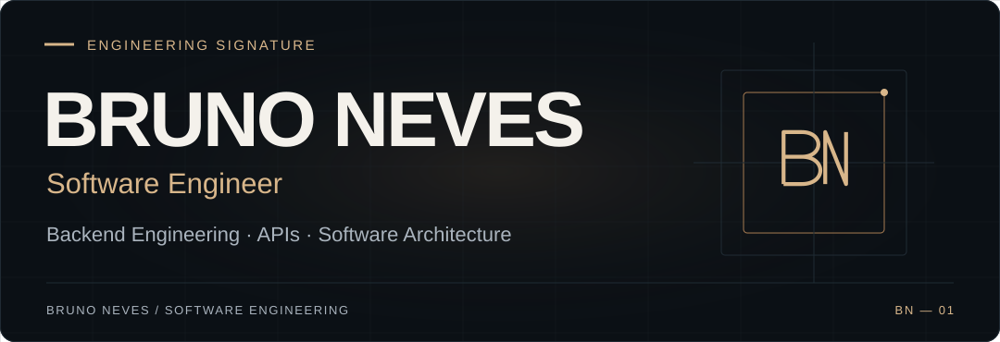
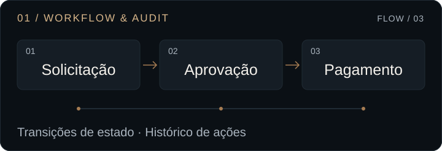
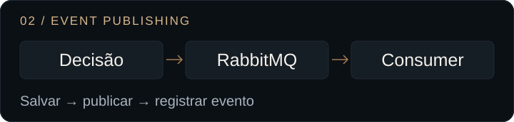
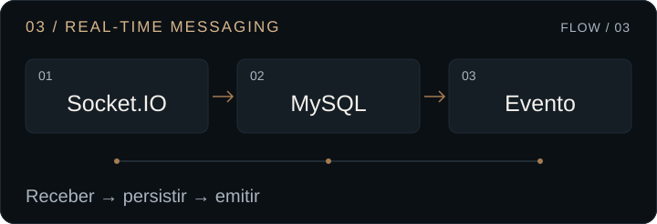
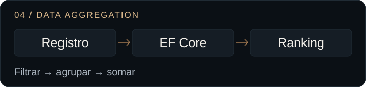
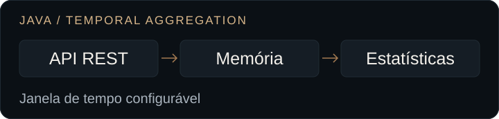
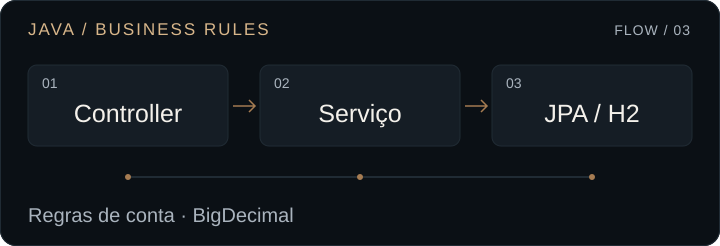
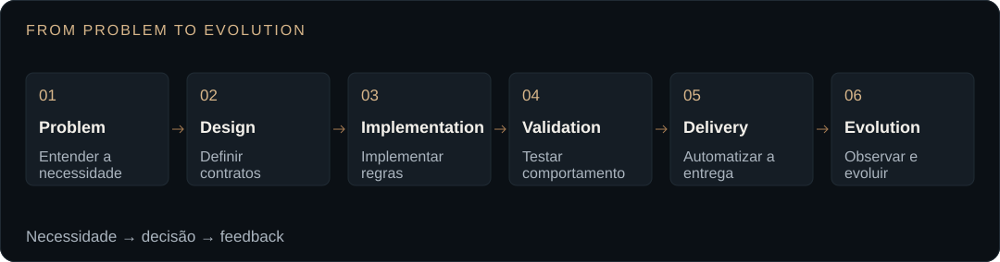
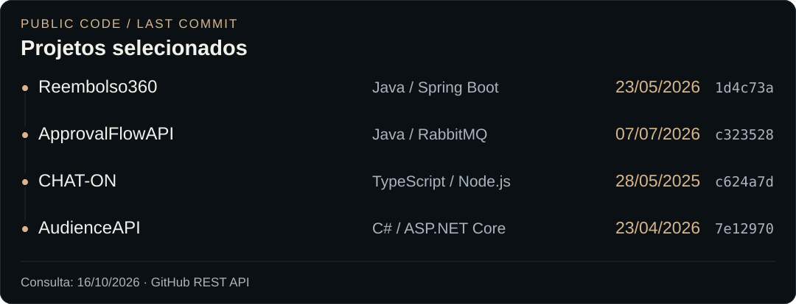

<picture>
  <source media="(max-width: 600px)" srcset="assets/hero-mobile.svg">
  
</picture>

**Software Engineer com foco em backend, Java e Spring Boot.** Minha trajetória passa por Ivory Integrada, Universidade de Barra Mansa e CSN. Gosto de traduzir necessidades de negócio em APIs claras, regras bem definidas e software que possa evoluir.

[LinkedIn ↗](https://www.linkedin.com/in/nevesntc/) &nbsp; · &nbsp; [E-mail ↗](mailto:brunonevesyt@gmail.com) &nbsp; · &nbsp; [Projetos ↓](#03--selected-engineering-projects)

Barra do Piraí, RJ · Brasil &nbsp; / &nbsp; Inglês avançado

## 01 / About the engineer

Sou Bruno Neves, formado em Engenharia de Software pela Universidade de Vassouras. Meu interesse está no que sustenta uma aplicação: contratos, regras de negócio, persistência, integrações e a organização do código ao longo do tempo.

**Java e Spring Boot são minha preferência técnica.** A experiência com Node.js, TypeScript, Python, PHP, C# e React amplia meu repertório para entender o produto de ponta a ponta. Valorizo comunicação clara, aprendizado contínuo e decisões que façam sentido para quem desenvolve e para quem utiliza o sistema.

## 02 / Engineering expertise

| Área | Como penso e trabalho |
| :--- | :--- |
| **Backend engineering** | APIs REST, regras de negócio, integrações e persistência de dados. |
| **Software design** | POO, SOLID, arquitetura em camadas e modularização para facilitar manutenção. |
| **Data** | SQL, PostgreSQL, MySQL, MongoDB e Supabase, respeitando o contexto de cada aplicação. |
| **Delivery & operations** | Docker, GitHub Actions e CI/CD; logs, observabilidade e troubleshooting para acompanhar a execução. |
| **Quality** | Testes automatizados, versionamento, Clean Code e responsabilidades bem delimitadas. |

## 03 / Selected engineering projects

Uma seleção de projetos públicos para explorar regras de negócio, mensageria, comunicação em tempo real e consultas de dados. Cada repositório permite examinar o código e seus limites.

### 01 — Reembolso360

Modela um fluxo de reembolso: comprovantes, análise do RH, aprovação adicional por valor e registro de pagamento. O histórico acompanha as mudanças de estado da solicitação.

**Java 21 · Spring Boot · Spring Security / JWT · PostgreSQL · Flyway**

- Regras de transição e visibilidade, aprovação pelo gestor para valores acima de R$ 300 e autorização por perfil nos endpoints de decisão.
- Serviços transacionais, histórico de ações, migrations SQL e testes unitários para cenários de aprovação e exigência de comprovantes.

[Explorar código ↗](https://github.com/nevesntc/Reembolso360-Backend) &nbsp; · &nbsp; [Ver regras de aprovação](https://github.com/nevesntc/Reembolso360-Backend/blob/1d4c73a593cb47d0e734b41550c54d8bf35fd84d/src/main/java/com/reembolso360/service/ReimbursementService.java)

---

### 02 — ApprovalFlowAPI

Simula solicitações e aprovações em um sistema interno. A decisão atualiza o estado da solicitação e publica um evento RabbitMQ, consumido e registrado no console.

**Java 21 · Spring Boot · Spring AMQP / RabbitMQ · JPA / H2 · Docker Compose**

- Entidade com regras para atualizar, aprovar ou rejeitar apenas solicitações pendentes; DTOs e tratamento global de erros.
- Publisher e consumers, testes de serviço com JUnit/Mockito e workflow de GitHub Actions configurado para testes, build Java e imagem Docker.

[Explorar código ↗](https://github.com/nevesntc/ApprovalFlowAPI) &nbsp; · &nbsp; [Ver serviço e eventos](https://github.com/nevesntc/ApprovalFlowAPI/blob/c3235284de43bfadf2623c2efdd23d199a8b24ee/src/main/java/br/com/neves/approvalflowapi/services/SolicitacaoService.java)

---

### 03 — CHAT-ON

Aplicação de chat que combina API HTTP e troca de mensagens em tempo real. O fluxo de envio persiste a mensagem antes de emitir o evento para o destinatário.

**TypeScript · Node.js · Express · Socket.IO · TypeORM · MySQL**

- Salas por usuário, eventos de envio e confirmação, persistência de mensagens e tratamento de erros no fluxo de socket.
- Organização em domínio, aplicação, infraestrutura e interfaces; fila em memória inicializada no bootstrap.

[Explorar código ↗](https://github.com/nevesntc/CHAT-ON) &nbsp; · &nbsp; [Ver fluxo em tempo real](https://github.com/nevesntc/CHAT-ON/blob/c624a7d2806a7f977863e9e988c3d24fbe7004e2/src/index.ts)

---

### 04 — AudienceAPI

Registra o tempo assistido de programas e expõe um ranking de audiência, com filtro opcional por data inicial.

**C# · ASP.NET Core · Entity Framework Core · SQLite**

- Consulta com filtro, agrupamento por programa, soma dos minutos e ordenação decrescente no repositório.
- Separação entre API, aplicação, domínio e infraestrutura, com injeção de dependências, migrations e testes de serviço e repositório.

[Explorar código ↗](https://github.com/nevesntc/AudienceAPI) &nbsp; · &nbsp; [Ver consulta do ranking](https://github.com/nevesntc/AudienceAPI/blob/7e129702d5e75009fb691c50e60aaf9b45f31c4b/src/Infrastructure/Repositories/AudienceRepository.cs)

<strong>Mais evidências / Estudos Java, produto e dados</strong>

#### API de Transações e Estatísticas

Exercício baseado no desafio backend do Itaú. **Java 17 · Spring Boot · JUnit · Docker.** Janela temporal configurável com `OffsetDateTime`, agregações via `DoubleSummaryStatistics` e armazenamento em `ConcurrentLinkedQueue`. Validação de entrada e rejeição de datas futuras, com testes de serviço no repositório.

[Explorar código ↗](https://github.com/nevesntc/API-de-Transacoes-e-Estatisticas) · [Ver agregação temporal](https://github.com/nevesntc/API-de-Transacoes-e-Estatisticas/blob/733c97ca85c7bd8ed7bb549b1993822f72462c60/src/main/java/com/neves/service/TransactionService.java)

#### Sistema de Conta Digital

API de demonstração para abertura de contas, depósitos, saques e ativação. **Java 11 · Spring Boot · JPA / H2 · JUnit / Mockito.** Valores com `BigDecimal`, verificações de saldo, conta ativa e duplicidade de CPF/número de conta. Operações de escrita com `@Transactional`, exceções de domínio e testes com repositório simulado.

[Explorar código ↗](https://github.com/nevesntc/Sistema-de-Conta-Digital) · [Ver regras de negócio](https://github.com/nevesntc/Sistema-de-Conta-Digital/blob/059137c76b78c049fe2d25d05a15de39f078fae5/src/main/java/br/com/magalupay/contadigital/domain/service/impl/ContaServiceImpl.java)

| Projeto | Problema e implementação |
| :--- | :--- |
| [Dashboard de Campanha ↗](https://github.com/nevesntc/Dashboard-de-Campanha) | Gestão de campanhas com React, Express e PostgreSQL. CRUD, validações de orçamento e datas, consultas parametrizadas e indicadores de campanha. |
| [Imóveis e Reservas ↗](https://github.com/nevesntc/API-de-Gerenciamento-de-Imoveis-e-Reservas) | API com Python, Flask, SQLAlchemy e Flask-RESTX. Cadastro de imóveis e reservas, confirmação e cancelamento, migrations e testes de modelos e endpoints. |

## 04 / Professional journey

Minha trajetória reúne experiências em **Ivory Integrada**, **Universidade de Barra Mansa (UBM)** e **Companhia Siderúrgica Nacional (CSN)**, em contextos de tecnologia e ambientes corporativos.

Como fundador da **MegaHype**, também desenvolvi uma perspectiva de produto e relacionamento com clientes: entender a necessidade faz parte de construir a solução.

## 05 / Technology stack

| | Especialidade | Ferramentas |
| :---: | :--- | :--- |
|  | **Backend principal** | **Java · Spring Boot** |
|  | Aplicações e serviços | TypeScript · Node.js |
|  | Dados e persistência | PostgreSQL · MySQL · MongoDB · Supabase |
|  | Entrega e automação | Docker · Git · GitHub Actions |
|  | Repertório complementar | Python · PHP · C# · React |

## 06 / Engineering mindset

<picture>
  <source media="(max-width: 600px)" srcset="assets/mindset-mobile.svg">
  
</picture>

**Entender antes de implementar.** Parto da necessidade, defino responsabilidades e contratos, implemento as regras e valido o comportamento. Automatizar a entrega, observar a execução e incorporar feedback completam o trabalho.

## 07 / Education & background

**Engenharia de Software** · Universidade de Vassouras · Conclusão em 2026 
Inglês avançado · Aprendizado contínuo em backend, qualidade e arquitetura de software.

## 08 / GitHub engineering activity

Último commit público na branch padrão de cada projeto selecionado. Datas e referências vêm da API do GitHub.

<picture>
  <source media="(max-width: 600px)" srcset="assets/activity-mobile.svg">
  
</picture>

Este recorte mostra atualizações dos repositórios, de qualquer autor. A atividade geral está no <a href="https://github.com/nevesntc?tab=overview">perfil do GitHub</a>.

## 09 / Let's connect

Aberto a oportunidades em engenharia de software, com interesse especial em backend. Se você recruta, lidera um time técnico ou quer trocar experiências sobre desenvolvimento, vamos conversar.

**[LinkedIn ↗](https://www.linkedin.com/in/nevesntc/)** &nbsp; / &nbsp; **[brunonevesyt@gmail.com ↗](mailto:brunonevesyt@gmail.com)** &nbsp; / &nbsp; **[GitHub ↗](https://github.com/nevesntc)**

---

 &nbsp; BRUNO NEVES / ENGINEERING SIGNATURE

